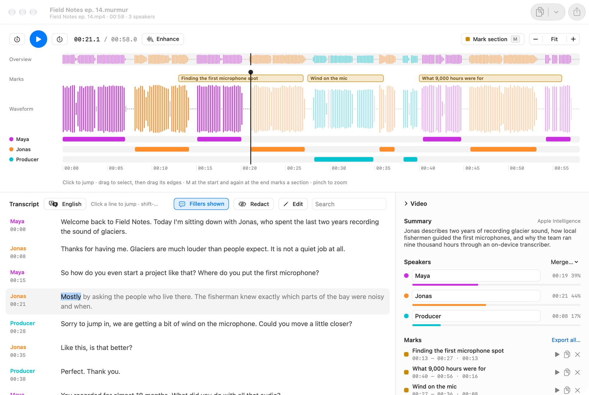

# Murmur

A Mac app that transcribes audio and video on your Mac and shows who spoke when on a timeline.
Nothing you open is uploaded.

**[Website](https://djui.github.io/murmur/) · [Download](https://github.com/djui/murmur/releases/latest)**

<picture>
  <source media="(prefers-color-scheme: dark)" srcset="site/assets/screenshot-dark.png">
  
</picture>

- **Transcript with speakers.** Voz writes the words, Who tells the speakers apart, Align tightens the
  word timing, Ear checks the spoken language first, and Tongue checks the text afterwards.
- **Timeline.** A speaker-colored waveform, one lane per speaker, an overview strip and zoom. Click to
  jump, drag to select.
- **Marks.** Press M at the start of a section and again at its end, or drag a selection and press M,
  to keep a named mark. Copy or export one mark or all of them.
- **Redaction.** One toggle hides names, phone numbers, emails, addresses and IDs (Desert Ant Redact) in the
  transcript, copies, exports and audio clips (bleeped). Show any single detail again from the sidebar.
- **Your colors.** Pick the speaker colors in Settings: Vivid, the professional Ink, Carbon, Tableau and
  Slate, Calm, Color-blind safe (Okabe–Ito), High contrast or Earth, each in light and dark. Every
  scheme is tested for contrast (≥3:1) and for speaker colors that stay distinct (OKLab distance).
- **Editing.** Fix words in place (edited words are re-timed against the audio), rename, merge and
  reassign speakers. Everything is undoable.
- **Export.** Plain text, text with timestamps, Markdown, SRT, WebVTT, word-level JSON, and audio or video
  clips (one file per mark, or joined).
- **Meeting recording.** Records your microphone ("Me") and the sound of other apps ("Others") as two
  tracks, with a live transcript in a small floating window that is hidden from screen sharing. ⌥⌘M marks
  a moment from any app.
- **Extras.** Uhm finds um/uh (hidden in exports by default), Clear enhances the audio for playback,
  transcription and export, and Apple Intelligence names the project and writes a summary (shown in the
  sidebar and included in Markdown and JSON exports).
- **Languages.** Ear names the spoken language; when it is unsure, Murmur reads a sample with Voz and
  lets Tongue decide. Languages Voz lacks can go to Apple's on-device transcriber instead.

Requires macOS 26 or later on Apple silicon (arm64 only: the Desert Ant SDK does not build for Intel).

## Building

```bash
brew install xcodegen
make run        # Debug build and launch
make test       # MurmurCore unit tests
make build      # Release build -> build/Murmur.app
make install    # Release build into /Applications
make dmg        # build/Murmur-<version>.dmg
```

On first launch Murmur downloads its speech models (about 515 MB) into
`~/Library/Application Support/com.djui.Murmur/Models`. Optional models (Uhm, Clear) download when turned on.

### Headless

The app binary can run the pipeline without UI, which is handy for testing:

```bash
build/DerivedData/Build/Products/Debug/Murmur.app/Contents/MacOS/Murmur -process talk.m4a -title YES -out talk.json
```

Flags (AppKit-style `-key value` pairs): `-language xx`, `-enhance YES`, `-fillers NO`, `-title YES`, `-stems mic.m4a,system.m4a`, `-out file.json`.

Other checks: `-live mic.m4a,system.m4a` streams two tracks through the live transcript,
`-clip media -ranges 7-14,20-28 -out folder [-joined YES] [-video YES]` cuts clips, and
`-mix mic.m4a,system.m4a -out recording.m4a` mixes stems the way a finished recording does.

On an M2 (Release build), ten minutes of audio take about 10 s: decode 0.6 s, language 1.5 s,
Voz 1.7 s, Who 1.6 s, Align 1.5 s, Uhm 3 s. Debug builds are much slower because the SDK's DSP code
is unoptimized; measure with `make build`.

## Releasing

`make release` bumps the version, builds a DMG, generates the Sparkle appcast and publishes a GitHub
Release. The Sparkle signing key lives in the release machine's login keychain (its public half is
`SUPublicEDKey` in `Murmur/Info.plist`); back it up with `generate_keys -x`, since updates can't be
signed without it.

Releases are notarized once these exist; until then they are signed with an Apple Development
identity and only run on the developer's Mac:

1. A **Developer ID Application** certificate in the keychain.
2. `xcrun notarytool store-credentials murmur` and `export NOTARY_PROFILE=murmur`.

## Layout

- `Packages/MurmurCore` — the project model, merging words with speakers, paragraphs, text formats,
  editing and waveform peaks. Pure Swift, unit tested.
- `Murmur/ML` — model downloads and the processing pipeline (Desert Ant SDK, Apple's transcriber,
  Foundation Models).
- `Murmur/Document` — the `.murmur` package (`project.json`, `peaks.bin`) and the per-window session.
- `Murmur/UI` — library, project window, timeline, transcript, sidebar, export, onboarding, settings.
- `Murmur/Recording` — microphone and system-audio capture, live transcript, the compact panel.

## Credits and licenses

Speech recognition by Voz, based on NVIDIA Parakeet TDT 0.6B v3 (CC BY 4.0). Who, Ear, Align, Uhm, Clear
and Tongue by Desert Ant Labs under the Desert Ant Labs Source-Available License (free up to 100k monthly
active devices). Loading a Desert Ant model reports an anonymous usage count to Desert Ant Labs for licensing.
Updates by Sparkle.
